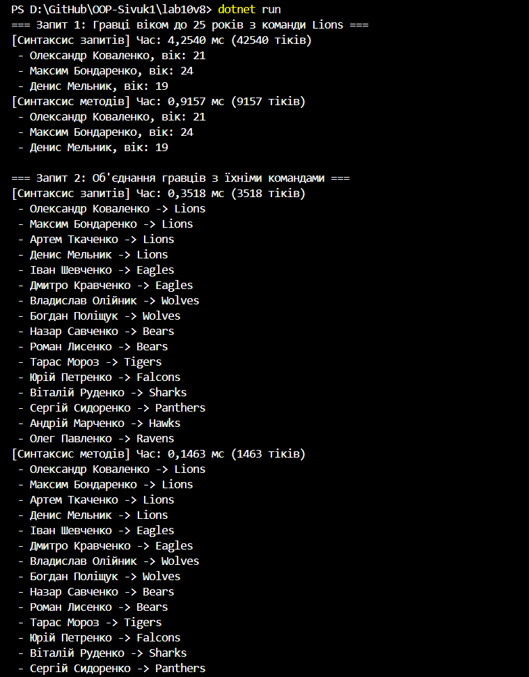

# Лабораторна робота №10
**Тема:** LINQ в дії: фільтри, join, агрегації. Продуктивність.  
**Варіант 8:** Сценарій «Спортивна ліга».

---

## 1. Опис класів сутностей і тестових даних

Для моделювання предметної області спортивної ліги створено два класи сутностей:

* **`Team`** — описує спортивну команду:
  * `Id` (`int`) — унікальний ідентифікатор команди;
  * `Name` (`string`) — назва команди;
  * `City` (`string`) — місто, яке представляє команда.
* **`Player`** — описує гравця ліги:
  * `Id` (`int`) — унікальний ідентифікатор гравця;
  * `Name` (`string`) — ім'я та прізвище гравця;
  * `TeamId` (`int`) — зовнішній ключ для зв'язку з командою (`Team.Id`);
  * `Age` (`int`) — вік гравця.

**Тестові дані:**  
Створено дві колекції `List<Team>` (10 команд: *Lions, Eagles, Wolves, Bears, Tigers, Falcons, Sharks, Panthers, Hawks, Ravens*) та `List<Player>` (16 гравців різного віку від 19 до 33 років, розподілених між усіма командами).

---

---

## 4. Висновки щодо продуктивності LINQ-операцій

1. **Ефект першого запуску (JIT-компіляція):** Перший виконаний у програмі запит (Запит 1 у синтаксисі запитів) завжди демонструє значно більший час виконання, ніж наступні аналогічні запити. Це пов'язано з витратами на JIT-компіляцію методів LINQ та ініціалізацію внутрішніх структур ітераторів під час першого звернення.
2. **Найдорожчі операції за часом:**
   * **Групування та агрегація (`GroupBy` + `Average` у Запиті 3):** Виявились найбільш ресурсомісткими серед прогрітих запитів, оскільки потребують побудови внутрішньої хеш-таблиці (`Lookup`) для розподілу елементів за ключами груп, виділення додаткової пам'яті під групи та повторного проходу по кожній групі для обчислення середнього значення.
   * **З'єднання колекцій (`Join` у Запитах 1–3):** Вимагає побудови внутрішньої хеш-таблиці для правої колекції (`teams`), щоб зіставити ключі за складністю $O(N + M)$, що дорожче за звичайну лінійну фільтрацію.
   * **Сортування (`OrderByDescending` у Запиті 4):** Має алгоритмічну складність $O(N \log N)$ і потребує буферизації всієї колекції перед поверненням першого елемента, тоді як спеціалізований метод `MaxBy` знаходить максимум за один лінійний прохід $O(N)$ без виділення пам'яті під сортування.
3. **Порівняння синтаксису запитів і методів:** На етапі компіляції C# перетворює синтаксис запитів (Query Syntax) на виклики методів розширення (Method Syntax), тому принципової різниці у швидкодії між ними немає — відмінності виникають лише тоді, коли в синтаксисі методів доступні оптимізовані перевантаження на кшталт `MaxBy`, яких немає у ключових словах синтаксису запитів.

## 5. Відповіді на контрольні питання

### 1. Поясніть різницю між синтаксисом запитів та синтаксисом методів у LINQ. Коли який краще використовувати?[cite: 3]

* **Синтаксис запитів (Query Syntax)** — це декларативний SQL-подібний запис із використанням ключових слів (`from`, `where`, `select`, `join`, `group by`). На етапі компіляції компілятор C# перетворює його на виклики стандартних методів розширення, тому різниці у швидкодії між двома підходами немає. Його краще використовувати для складних запитів із кількома об'єднаннями (`join`), проміжними змінними (`let`) та багаторівневим групуванням, оскільки в такому вигляді структура запиту читається значно легше.
* **Синтаксис методів (Method Syntax)** — це ланцюжок викликів методів розширення (`Where()`, `Select()`, `Join()`, `OrderBy()`) із передачею лямбда-виразів. Він має ширші можливості, оскільки містить багато операцій, для яких не існує ключових слів у синтаксисі запитів (наприклад, `Take`, `Skip`, `Count`, `FirstOrDefault`, `MaxBy`, `Distinct`). Його доцільно використовувати для простих фільтрацій, пагінації, агрегуючих обчислень та динамічної побудови запитів за умовами.

### 2. Для чого використовуються операції `Join` та `GroupJoin`? У чому їхня відмінність?[cite: 3]

Обидві операції призначені для комбінування елементів із двох колекцій на основі відповідності значень спільних ключів[cite: 1]:

* **`Join`** реалізує внутрішнє з'єднання (аналог `INNER JOIN` у SQL) і повертає плоску послідовність пар збігів. Кожен елемент першої (зовнішньої) колекції поєднується з кожним відповідним елементом другої (внутрішньої) колекції; якщо для елемента не знайдено жодного збігу, він не потрапляє до результату.
* **`GroupJoin`** реалізує групове з'єднання (аналог `LEFT OUTER JOIN` із групуванням) і повертає ієрархічний результат. Для кожного елемента зовнішньої колекції створюється об'єкт, що містить сам цей елемент і вкладену колекцію всіх відповідних йому елементів із внутрішньої колекції (навіть якщо збігів немає — тоді вкладена колекція буде порожньою).

### 3. Наведіть приклади агрегуючих операцій LINQ та поясніть їхнє призначення[cite: 3].

Агрегуючі операції виконують обчислення над набором значень послідовності та зводять їх до одного підсумкового результату, викликаючи негайне виконання запиту[cite: 1]:

* `Count()` / `LongCount()` — підраховують загальну кількість елементів у колекції або кількість елементів, що відповідають заданій умові[cite: 1].
* `Sum()` — обчислює суму числових значень елементів або вказаної числової властивості об'єктів[cite: 1].
* `Average()` — обчислює середнє арифметичне числових значень вибірки[cite: 1].
* `Min()` / `Max()` (а також `MinBy()` / `MaxBy()`) — знаходять найменше або найбільше значення (або сам елемент із мінімальним/максимальним ключем) у послідовності[cite: 1].
* `Aggregate()` — універсальний метод згортки, який дозволяє задати власну накопичувальну функцію для послідовної обробки елементів (наприклад, обчислення добутку або формування складного рядка)[cite: 1].

### 4. Як можна виміряти продуктивність LINQ-запитів? Які фактори впливають на неї?[cite: 3]

* **Способи вимірювання:** Для базового заміру часу виконання в коді застосовується клас `System.Diagnostics.Stopwatch` із обов'язковою матеріалізацією запиту (наприклад, через `.ToList()` або `.FirstOrDefault()`), щоб зафіксувати реальне обчислення, а не лише створення об'єкта-ітератора[cite: 1, 3]. Для точного аналізу швидкодії з урахуванням прогріву середовища та витрат пам'яті використовується бібліотека `BenchmarkDotNet`.
* **Фактори впливу на продуктивність:**
  * *JIT-компіляція («холодний старт»):* перший виклик запиту завжди триває довше через компіляцію проміжного коду та ініціалізацію внутрішніх структур даних.
  * *Алгоритмічна складність операцій:* лінійні операції (`Where`, `First`, `MaxBy` зі складністю $O(N)$) працюють швидше за операції з побудовою хеш-таблиць (`Join`, `GroupBy` — $O(N + M)$) та сортуванням (`OrderBy` — $O(N \log N)$).
  * *Порядок операцій у конвеєрі:* виконання фільтрації (`Where`) до операцій з'єднання чи сортування зменшує обсяг даних для ресурсомісткої обробки.
  * *Алокації пам'яті та множинна ітерація:* створення проміжних анонімних об'єктів, надмірне використання `ToList()` або повторний прохід по відкладеному запиту збільшують навантаження на пам'ять і збирач сміття.
  * *Тип джерела даних (`IEnumerable` проти `IQueryable`):* під час роботи з базами даних вирішальним є те, чи транслюється запит у SQL на боці сервера, чи вся таблиця завантажується в пам'ять застосунку.