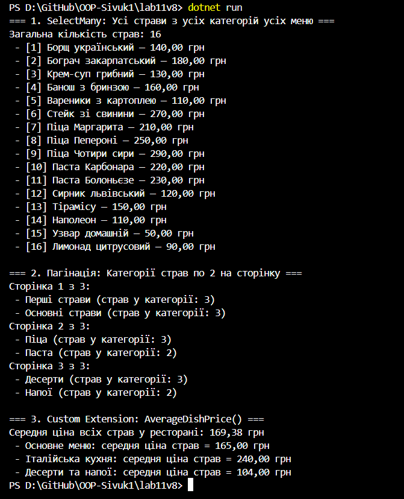

# Лабораторна робота №11
**Тема:** LINQ: `SelectMany`, пагінація й custom extensions.  
**Варіант 8:** Сценарій «Меню ресторану та його категорії страв».

---

## 1. Опис класів сутностей і тестових даних

Для моделювання ієрархічної структури ресторанного меню створено три класи сутностей із вкладеними колекціями:

* **`RestaurantMenu`** — описує окреме меню ресторану:
  * `Id` (`int`) — унікальний ідентифікатор меню;
  * `Name` (`string`) — назва меню;
  * `Categories` (`List<DishCategory>`) — вкладена колекція категорій страв, що входять до цього меню.
* **`DishCategory`** — описує категорію страв у межах меню:
  * `Id` (`int`) — унікальний ідентифікатор категорії;
  * `Name` (`string`) — назва категорії;
  * `Dishes` (`List<Dish>`) — вкладена колекція страв цієї категорії.
* **`Dish`** — описує окрему страву:
  * `Id` (`int`) — унікальний ідентифікатор страви;
  * `Name` (`string`) — назва страви;
  * `Price` (`decimal`) — ціна страви у гривнях.

**Тестові дані:**  
Створено 3 об'єкти `RestaurantMenu` (*«Основне меню»*, *«Італійська кухня»*, *«Десерти та напої»*), які містять 6 вкладених категорій `DishCategory` (*«Перші страви»*, *«Основні страви»*, *«Піца»*, *«Паста»*, *«Десерти»*, *«Напої»*) та 16 страв `Dish` із цінами від 50 до 290 грн.

---

## 2. Реалізація LINQ-запитів та методу розширення


---

## 3. Відповіді на контрольні питання

### 1. Для чого використовується оператор `SelectMany`? Наведіть приклад, що демонструє його відмінність від `Select`.

Оператор **`SelectMany`** призначений для проєкції кожного елемента вихідної колекції у вкладену послідовність із подальшим об'єднанням (*flattening*) усіх цих вкладених послідовностей в одну плоску колекцію результатів.

* **Відмінність від `Select`:**
  * Якщо виконати `menus.Select(m => m.Categories)`, результатом буде колекція колекцій — `IEnumerable<List<DishCategory>>` (структура «один до одного» на рівні списків).
  * Якщо виконати `menus.SelectMany(m => m.Categories)`, усі внутрішні списки категорій об'єднуються в єдину лінійну послідовність — `IEnumerable<DishCategory>` (структура «один до багатьох»), із якою зручно працювати далі без вкладених циклів.

### 2. Як реалізувати пагінацію даних за допомогою LINQ? Які методи для цього використовуються?

Пагінація в LINQ реалізується шляхом комбінації двох методів розбиття послідовності:
1. **`Skip(int count)`** — пропускає задану кількість елементів від початку колекції (для сторінки з номером `page` та розміром `pageSize` пропускається `(page - 1) * pageSize` елементів).
2. **`Take(int count)`** — вибирає наступні `pageSize` елементів після пропущених.

Порядок виклику є критично важливим: спочатку завжди застосовується `Skip(...)`, а потім `Take(...)`. Перед пагінацією колекцію бажано впорядкувати (`OrderBy`), щоб гарантувати стабільний порядок елементів між сторінками.

### 3. Поясніть концепцію методів розширення. Як вони інтегруються з LINQ?

**Методи розширення (Extension Methods)** — це спеціальні статичні методи, оголошені всередині статичного неузагальненого класу, перший параметр яких має модифікатор `this` перед типом, що розширюється. Вони дозволяють додавати нову функціональність до вже існуючих класів, структур або інтерфейсів без зміни їхнього вихідного коду та без успадкування, причому викликаються так само, як звичайні екземплярні методи через крапку.

**Інтеграція з LINQ:** Уся стандартна бібліотека LINQ to Objects (клас `System.Linq.Enumerable`) побудована саме як набір методів розширення для інтерфейсу `IEnumerable<T>`. Завдяки цьому будь-яка колекція, що реалізує `IEnumerable<T>` (масиви, `List<T>`, словники, а також власні методи розширення), автоматично інтегрується в єдиний ланцюжок викликів LINQ.

### 4. Наведіть приклад власного методу розширення для `IEnumerable<T>` та поясніть його призначення.

```csharp
public static class DishCategoryExtensions
{
    public static decimal AverageDishPrice(this IEnumerable<DishCategory> categories)
    {
        var dishes = categories.SelectMany(c => c.Dishes).ToList();
        return dishes.Count > 0 ? dishes.Average(d => d.Price) : 0m;
    }
}
```

**Призначення:** Цей метод розширює будь-яку послідовність категорій страв (`IEnumerable<DishCategory>`), інкапсулюючи повторювану бізнес-логіку підрахунку середньої вартості страв. Він розгортає всі страви з переданих категорій за допомогою `SelectMany`, безпечно перевіряє наявність елементів (щоб уникнути винятку `InvalidOperationException` при виклику `Average()` на порожній колекції) та повертає середню ціну, роблячи основний код програми компактним і читабельним.