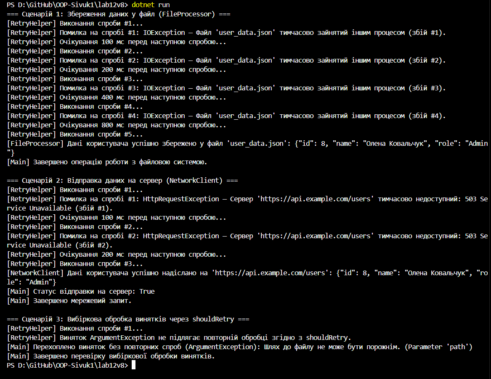

# Лабораторна робота №12
**Тема:** Обробка IO/мережевих помилок та патерн Retry.  
**Варіант 8:** Сценарій «Збереження даних користувача».

---

## 1. Опис реалізованих класів

Для моделювання відмовостійкого збереження даних користувача у файл та відправки їх на віддалений сервер реалізовано три класи:

* **`FileProcessor`** — клас для імітації роботи з файловою системою:
  * Метод `void SaveUserData(string path, string userData)` перевіряє коректність шляху (викидає `ArgumentException`, якщо шлях порожній) та імітує тимчасову помилку вводу/виводу `IOException` під час перших 4 викликів, після чого на 5-й спробі успішно зберігає дані.
* **`NetworkClient`** — клас для імітації мережевої взаємодії:
  * Метод `bool PostUserData(string url, string userData)` імітує мережевий збій `HttpRequestException` під час перших 2 викликів, після чого на 3-й спробі успішно передає дані та повертає `true`.
* **`RetryHelper`** — узагальнений статичний допоміжний клас для реалізації патерну Retry:
  * Метод `public static T ExecuteWithRetry<T>(Func<T> operation, int retryCount = 3, TimeSpan initialDelay = default, Func<Exception, bool>? shouldRetry = null)` виконує передану операцію, перехоплює винятки, перевіряє доцільність повтору через делегат `shouldRetry`, логує кожну невдалу спробу та застосовує експоненційну затримку перед наступним повтором.

---

## 2. Консольний вивід роботи програми (`Main`)

---

## 3. Висновок про принцип роботи експоненційної затримки

У реалізованому варіанті час очікування перед кожною наступною повторною спробою обчислюється за формулою $\text{delay} = \text{initialDelay} \times 2^{\text{attempt}}$, тому при початковій затримці `100 мс` інтервали очікування зростають у геометричній прогресії: `100 мс` $\rightarrow$ `200 мс` $\rightarrow$ `400 мс` $\rightarrow$ `800 мс`. Такий підхід дозволяє уникнути надмірного навантаження на зайнятий файл чи перевантажений сервер частими запитами, надаючи системі дедалі більше часу на відновлення працездатності між спробами.

---

## 4. Відповіді на контрольні запитання

### 1. Які типи винятків найчастіше виникають при роботі з файлами та мережею?

* **При роботі з файлами та потоками даних (простір імен `System.IO`):**
  * `IOException` — базовий виняток вводу/виводу (наприклад, файл уже відкритий і заблокований іншим процесом).
  * `FileNotFoundException` — спроба звернутися до файлу, якого не існує за вказаним шляхом.
  * `DirectoryNotFoundException` — вказано неіснуючий каталог або шлях.
  * `UnauthorizedAccessException` — відсутні права доступу до файлу чи папки або спроба запису у файл із атрибутом «лише для читання».
  * `PathTooLongException` — перевищено максимально допустиму довжину шляху в операційній системі.
* **При роботі з мережею (простори імен `System.Net` та `System.Net.Http`):**
  * `HttpRequestException` — помилка під час виконання HTTP-запиту (проблеми з DNS, відмова з'єднання, помилки рівня транспорту або статуси відповіді на кшталт `503 Service Unavailable`).
  * `SocketException` — низькорівнева помилка мережевого сокета (розрив з'єднання, недосяжність вузла).
  * `TaskCanceledException` / `TimeoutException` — перевищення часу очікування відповіді від віддаленого сервера.

### 2. Поясніть принцип роботи патерну Retry. Коли його доцільно використовувати?

**Патерн Retry (повторних спроб)** полягає в автоматичному перезапуску операції, яка завершилася збоєм, у розрахунку на те, що причина помилки є тимчасовою (transient fault) і наступна спроба через певний інтервал часу завершиться успішно. Виконання повторюється до отримання успішного результату або до вичерпання заданого ліміту спроб (`retryCount`).

**Коли доцільно використовувати:**
* при короткочасних втратах мережевого з'єднання, таймаутах або тимчасовому перевантаженні зовнішніх API та баз даних;
* при тимчасовому блокуванні локальних файлів іншими процесами.

**Коли використовувати недоцільно:** при постійних (незворотних) помилках, які не зникнуть самі по собі — наприклад, помилках валідації даних (`ArgumentException`), відсутності прав доступу (`401 Unauthorized`, `403 Forbidden`) або зверненні до неіснуючого ресурсу (`404 Not Found`).

### 3. Як реалізувати експоненційну затримку між повторними спробами?

Експоненційна затримка (Exponential Backoff) реалізується шляхом множення базового інтервалу очікування (`initialDelay`) на степінь двійки (або іншого множника), що залежить від порядкового номера поточної повторної спроби (`attempt`):

$$\text{delay} = \text{initialDelay} \times 2^{\text{attempt}}$$

У коді C# це реалізується через `TimeSpan.FromMilliseconds(initialDelay.TotalMilliseconds * Math.Pow(2, attempt))` із подальшим призупиненням потоку через `Thread.Sleep(delay)` (для синхронного коду) або `await Task.Delay(delay)` (для асинхронного коду). Для високонавантажених систем до цієї формули також додають невелике випадкове відхилення (*jitter*), щоб клієнти не робили повторні запити одночасно.

### 4. Для чого потрібен делегат `shouldRetry` у допоміжному класі `RetryHelper`?

Делегат `Func<Exception, bool>? shouldRetry` виконує роль фільтра (предиката) винятків, дозволяючи відокремити **тимчасові помилки**, які варто повторювати, від **фатальних або логічних помилок**, для яких повторні спроби не мають сенсу. Якщо під час виконання операції виникає виняток, `RetryHelper` передає його у `shouldRetry`: якщо функція повертає `true` (наприклад, для `IOException` чи `HttpRequestException`), виконується затримка та повторна спроба; якщо `false` (наприклад, для `ArgumentException`), `RetryHelper` негайно припиняє цикл і прокидає виняток далі, економлячи час і ресурси програми.