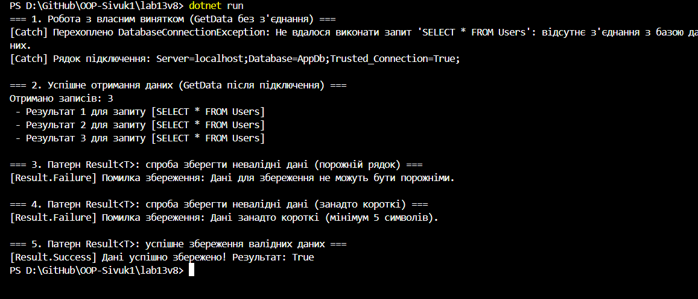

# Лабораторна робота №13
**Тема:** Власні винятки та патерн Result.  
**Варіант 8:** Сценарій «Робота з базою даних (імітація)».

---

## 1. Опис реалізованих класів

Для демонстрації двох підходів до обробки помилок у предметній області роботи з базою даних реалізовано три основні класи:

* **`DatabaseConnectionException`** — власний клас винятку, успадкований від `System.Exception`:
  * Містить додаткову властивість `ConnectionString` (`string`), яка зберігає рядок підключення, що спричинив збій.
  * Реалізує стандартні конструктори (без параметрів, з рядком підключення, з повідомленням, із внутрішнім винятком `innerException` та конструктор серіалізації `SerializationInfo, StreamingContext`).
* **`Result<T>`** — узагальнений клас для реалізації патерну Result:
  * Властивості: `IsSuccess` (`bool`), `Value` (`T`), `Error` (`string`).
  * Приватний конструктор `Result(T value, bool isSuccess, string error)` для контролю створення об'єкта.
  * Статичні фабричні методи: `Success(T value)`, `Failure(string error)` та `Failure(Exception ex)`.
* **`DataService`** — сервіс імітації взаємодії з базою даних:
  * `List<string> GetData(string query)` — перевіряє стан підключення до БД; якщо з'єднання не встановлено, викидає власний виняток `DatabaseConnectionException`, інакше повертає список записів.
  * `Result<bool> SaveData(string data)` — перевіряє валідність вхідних даних без викидання винятків: повертає `Result<bool>.Failure(...)`, якщо рядок порожній або закороткий, і `Result<bool>.Success(true)` при успішному збереженні.

---

## 2. Консольний вивід роботи програми (`Main`)

---

## 3. Висновок щодо вибору між винятками та патерном `Result<T>`

У сценарії роботи з базою даних вибір підходу залежить від природи помилки:

* Для методу **`GetData`** доцільно використовувати виняток **`DatabaseConnectionException`**, оскільки відсутність з'єднання із сервером БД є критичною інфраструктурною аварією, за якої подальше виконання запиту неможливе, а викликаючий код повинен отримати контекст збою (`ConnectionString`) і виконати відновлення або логування.
* Для методу **`SaveData`** значно ефективніше використовувати **`Result<bool>`**, оскільки передача користувачем невалідних чи порожніх даних — це очікуваний сценарій бізнес-логіки, який має оброблятися як звичайний результат перевірки без накладних витрат на генерацію та перехоплення винятків.

---

## 4. Відповіді на контрольні запитання

### 1. Навіщо створювати власні типи винятків? Які переваги це дає?

Власні типи винятків створюються для точного представлення специфічних помилок предметної області застосунку, які неможливо однозначно описати стандартними системними класами на кшталт `Exception` або `InvalidOperationException`.

**Основні переваги:**
* **Семантична зрозумілість коду:** назва класу (наприклад, `DatabaseConnectionException`) одразу вказує на причину збою.
* **Вибіркове перехоплення (`catch`):** дозволяє обробляти помилки певного типу окремо від інших збоїв на потрібному рівні архітектури.
* **Збереження додаткового контексту:** у власний виняток можна додати спеціалізовані властивості (наприклад, `ConnectionString`, код помилки чи суму операції), які спрощують діагностику та відновлення роботи системи.

### 2. Які стандартні конструктори рекомендується реалізовувати для власних винятків?

Згідно з рекомендаціями проєктування .NET, власний клас винятку повинен містити чотири базові конструктори (а також конструктори для ініціалізації власних властивостей):
1. **Конструктор без параметрів** (`MyException()`) — створює екземпляр винятку зі стандартним повідомленням за замовчуванням.
2. **Конструктор із текстовим повідомленням** (`MyException(string message)`) — дозволяє передати опис конкретної помилки.
3. **Конструктор із повідомленням та внутрішнім винятком** (`MyException(string message, Exception innerException)`) — необхідний для обгортання низькорівневих винятків (наприклад, `SocketException`) у високорівневий виняток предметної області без втрати першопричини та стеку викликів.
4. **Конструктор серіалізації** (`protected MyException(SerializationInfo info, StreamingContext context)`) — забезпечує коректну серіалізацію та десеріалізацію об'єкта винятку під час передачі між межами доменів застосунку чи мережею.

### 3. Поясніть патерн Result. У яких випадках його використання є більш доцільним, ніж викидання винятків?

**Патерн Result** — це підхід до обробки помилок, за якого метод замість викидання винятку повертає спеціальний об'єкт-контейнер (`Result<T>`), що явно містить або успішний результат (`Value`), або інформацію про помилку (`Error`) та прапорець стану (`IsSuccess`).

Його використання є більш доцільним у таких випадках:
* **Очікувані помилки бізнес-логіки та валідації:** помилки введення користувача, порушення форматів даних, відсутність запису за пошуком або недостатній баланс рахунку.
* **Високі вимоги до продуктивності:** створення та розкручування стеку викликів при викиданні винятку (`throw`) є ресурсомісткою операцією, тоді як повернення об'єкта `Result<T>` працює зі швидкістю звичайного повернення значення.
* **Явність контракту методу:** сигнатура методу `Result<T>` змушує розробника перевірити можливу невдачу на етапі компіляції, на відміну від винятків, які можуть бути несподівано пропущені.

### 4. Які сценарії краще обробляти через винятки, а які через патерн Result?

* **Через винятки (Exceptions)** обробляють **непередбачувані, критичні та інфраструктурні збої**, які порушують нормальний хід роботи програми й не можуть бути вирішені локально в межах поточного методу: втрата з'єднання з базою даних або мережею, відсутність обов'язкового конфігураційного файлу, помилки доступу до диска, переповнення пам'яті.
* **Через патерн Result** обробляють **очікувані та передбачувані сценарії невдачі**, що є частиною штатної бізнес-логіки застосунку: невалідні вхідні дані (порожні рядки, неправильний формат email), спроба зареєструвати вже існуючого користувача, відмова в операції через бізнес-правила (наприклад, недостатньо коштів або спроба повторно призначити вже зайняте завдання).