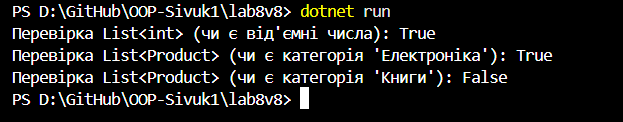

# Лабораторна робота №8 — Варіант 8

**Тема:** Делегати й лямбда-вирази у практиці колекцій: `CollectionHelper<T>`  
**Назва проєкту:** `lab8v8`

## Реалізований метод

У класі `CollectionHelper<T>` реалізовано статичний метод `Any`:

public static bool Any<T>(IEnumerable<T> collection, Predicate<T> predicate) ;

### Контрольні запитання

1. **Що таке делегат і для чого він використовується?**
   Делегат — це тип, що представляє посилання на метод із певною сигнатурою та типом повернення[cite: 1]. Він використовується для передачі методів як параметрів у інші методи, організації зворотних викликів (callbacks) та обробки подій[cite: 1].

2. **У чому полягає різниця між Func та Action?**
   * **`Action`** — узагальнений делегат для методів, які приймають параметри та не повертають значення (`void`)[cite: 1].
   * **`Func`** — узагальнений делегат для методів, які приймають параметри та повертають значення зазначеного типу (`TResult`)[cite: 1].

3. **Як лямбда-вирази спрощують роботу з делегатами?**
   Лямбда-вирази надають лаконічний синтаксис `(параметри) => вираз` для створення анонімних функцій безпосередньо у місці виклику[cite: 1]. Це дозволяє уникнути оголошення окремих обособлених методів[cite: 1].

4. **Які переваги дають узагальнені методи при роботі з колекціями?**
   * **Строга типізація (Type Safety):** помилки невідповідності типів виявляються ще під час компіляції[cite: 1].
   * **Повторне використання коду:** один і той самий метод працює з колекціями будь-яких типів[cite: 1].
   * **Продуктивність:** відсутність операцій упакування та розпакування (boxing/unboxing) для значущих типів[cite: 1].